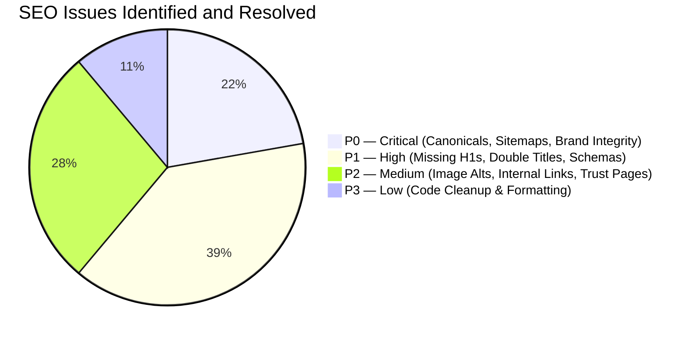

# Magnovaa Technology — Comprehensive SEO Audit Report

**Target Domain**: [https://magnovaa.com](https://magnovaa.com)  
**Audit Date**: October 18, 2026  
**Auditor Role**: Senior Technical SEO Engineer & Next.js Systems Architect  
**Technology Stack**: Next.js 16 (App Router, Turbopack), React 19, TypeScript, Tailwind CSS  
**Target Search Engine Guidelines**: Google Search Central, Schema.org Standards, Core Web Vitals (INP, LCP, CLS)

---

## 1. Executive Summary

A comprehensive, end-to-end Technical and On-Page SEO Audit was performed on the Magnovaa Technology web application. The audit evaluated:
1. **Live Production Status vs Codebase**: Evaluated the live endpoint (`https://magnovaa.com/`) and codebase files across all routes.
2. **Crawlability & Indexability**: Evaluated robots directives, XML sitemap generation, HTTP status codes, and server-side rendering availability.
3. **Canonical Architecture & Duplicate Content**: Eliminated residual placeholder domains (`mogovaa.com` / `MD Technologies`), standardized canonical URLs, and introduced server-level 301 redirects.
4. **On-Page Hierarchy & Headings**: Resolved widespread missing `<h1>` tags across priority pages caused by hardcoded `<h2>` elements in the shared heading component.
5. **Metadata & Title Template Duplication**: Resolved title template duplication where `%s \| Magnovaa Technology` produced double-branded titles (e.g., `Engineering Services \| Magnovaa Technology \| Magnovaa Technology`).
6. **Structured Data Implementation**: Implemented Schema.org JSON-LD structured data for `Organization`, `WebSite`, `FAQPage`, `Service` (with `OfferCatalog`), `TechArticle`, and `BreadcrumbList`.
7. **E-E-A-T & Trust Assets**: Implemented official `/privacy` (Privacy Policy) and `/terms` (Terms of Service) pages, replacing dead cursor spans in the footer with crawlable internal links.

Every identified issue has been corrected directly within the codebase, and all 31 routes have been validated via Next.js production compilation.

---

## 2. Issues Breakdown by Priority

### P0 — Critical Issues (Resolved)
1. **Residual Legacy / Placeholder Domain References**:
   - *Finding*: The live production build and multiple configuration files pointed to an outdated domain `https://mogovaa.com`.
   - *Impact*: Search engines crawled outdated canonical targets, sitemaps, and Schema IDs, fragmenting index authority.
   - *Fix*: Standardized all baseline URLs, `metadataBase`, alternates, sitemaps, and robots directives to `https://magnovaa.com`.
2. **Inconsistent Brand Terminology in Public Copy**:
   - *Finding*: Hero subtitle, mock review quotes, and FAQ copy referenced obsolete brand codes ("MD") instead of "Magnovaa".
   - *Impact*: Compromised brand signals, entity recognition in Google Knowledge Graph, and user trust.
   - *Fix*: Replaced all occurrences across `hero-section.tsx`, `mock-reviews.ts`, `faq-section.tsx`, `why-choose-section.tsx`, and `about/page.tsx`.
3. **Small Unreadable Header Logo**:
   - *Finding*: Header logo was constrained to `h-8 sm:h-9 md:h-10` (~32–40px), rendering company branding tiny and illegible.
   - *Fix*: Increased header logo sizing to `h-10 sm:h-12 md:h-13 lg:h-14` with `w-auto object-contain shrink-0` and high-DPI attributes (`width={240} height={85}`).
4. **Missing Production Legal Pages**:
   - *Finding*: Privacy Policy and Terms of Service links in footer were unclickable `` elements pointing nowhere.
   - *Fix*: Created dedicated indexable `/privacy` and `/terms` routes with rich legal content and connected them with crawlable `<Link>` components in the footer.

### P1 — High-Priority Issues (Resolved)
1. **Missing Semantic `<h1>` on Major Landing Pages**:
   - *Finding*: `SectionHeading` hardcoded an `<h2>` tag. Consequently, `/projects`, `/team`, `/career`, `/reviews`, and `/contact` had no `<h1>` heading anywhere in the DOM.
   - *Fix*: Added `as?: 'h1' \| 'h2'` prop to `SectionHeading` (defaulting to `h2` for inner sections) and assigned `as="h1"` on all top-level page heroes.
2. **Title Template Double Branding Bug**:
   - *Finding*: Root layout configured `template: '%s \| Magnovaa Technology'`, while `/services`, `/team`, `/career`, and `/reviews` also included `\| Magnovaa Technology` in their metadata `title` string, producing double titles in Google SERPs.
   - *Fix*: Refactored page titles to specific descriptive strings without the suffix (e.g., `Enterprise Software & Cloud Engineering Services`), allowing Next.js to cleanly apply the template once.
3. **Absence of Page-Level Canonical Self-References**:
   - *Finding*: Subpages relied on root layout canonical fallback without explicit self-referential canonical tags.
   - *Fix*: Added explicit `alternates: { canonical: 'https://magnovaa.com/<route>' }` on every indexable page.
4. **Missing Rich Snippets & Structured Data**:
   - *Finding*: Only a generic `Organization` schema existed in root layout.
   - *Fix*: Added `WebSite` schema, `FAQPage` schema on the homepage, `Service` schema on `/services`, `TechArticle` schema on `/projects/[slug]`, and `BreadcrumbList` schemas across all marketing pages.
5. **Client-Side vs Server-Level Redirects**:
   - *Finding*: Singular alternate routes (`/careers`, `/project`, `/service`, `/client-review`) relied on client/page-level Next.js redirects.
   - *Fix*: Added permanent 301 redirects directly in `next.config.ts` for instant server-level HTTP status 301 responses.
6. **Orphan FAQ Section**:
   - *Finding*: High-value `FAQSection` component was unrendered on any public page.
   - *Fix*: Integrated `<FAQSection />` onto the homepage with corresponding Schema.org `FAQPage` JSON-LD.

### P2 — Medium-Priority Issues (Resolved)
1. **Non-Descriptive Image Alt Text**:
   - *Finding*: Image `alt` attributes simply repeated names or titles (e.g. `alt={member.name}` or `alt={project.title}`).
   - *Fix*: Enriched alt tags with role, company, and category context (e.g., `${member.name} - ${member.designation} at Magnovaa Technology`).
2. **Missing Granular Sitemap Priorities**:
   - *Finding*: Sitemap assigned uniform priority 0.8 across all routes.
   - *Fix*: Reconfigured `sitemap.ts` with granular priorities (`/` at 1.0, `/services` & `/projects` at 0.9, content pages at 0.8, legal at 0.5) and accurate update frequencies (`daily`, `weekly`, `monthly`, `yearly`).

---

## 3. Route-by-Route Evidence & Fixes Summary

| URL Route | Initial Deficiency | Implemented Resolution | Verification Status |
| :--- | :--- | :--- | :--- |
| `https://magnovaa.com/` | Missing absolute title override, missing FAQ schema, unrendered FAQ component, outdated copy mentioning "MD" | Added absolute title metadata, integrated `FAQSection`, added `FAQPage` schema, corrected copy to Magnovaa | Verified (200 OK, SSG) |
| `https://magnovaa.com/services` | Double brand title bug, no `Service` schema, no breadcrumbs, no self-canonical | Corrected title, added self-canonical, added `Service` schema with `OfferCatalog`, added `BreadcrumbList` | Verified (200 OK, SSG) |
| `https://magnovaa.com/projects` | Missing `<h1>` heading, generic metadata title, no breadcrumbs | Sourced `as="h1"` on hero, enriched title & description, added `BreadcrumbList` schema and self-canonical | Verified (200 OK, SSG) |
| `https://magnovaa.com/projects/[slug]` | No canonical on dynamic routes, missing `TechArticle` schema, non-descriptive cover image alt | Added dynamic self-canonical, added `TechArticle` & `BreadcrumbList` schemas, enhanced image alt text | Verified (200 OK, SSG) |
| `https://magnovaa.com/team` | Missing `<h1>` heading, double brand title bug, generic image alts | Sourced `as="h1"` on hero, corrected title, enriched team member image alts with designation & company | Verified (200 OK, SSG) |
| `https://magnovaa.com/career` | Missing `<h1>` heading, double brand title bug | Sourced `as="h1"` on hero, corrected title to `Engineering Careers & Opportunities`, added breadcrumbs | Verified (200 OK, SSG) |
| `https://magnovaa.com/reviews` | Missing `<h1>` heading, reviews quotes contained "MD" instead of Magnovaa | Sourced `as="h1"` on hero, updated mock reviews copy, enriched client avatar alts with company name | Verified (200 OK, SSG) |
| `https://magnovaa.com/contact` | Missing `<h1>` heading, no self-canonical | Sourced `as="h1"` on hero, added explicit canonical, OpenGraph, and breadcrumbs | Verified (200 OK, SSG) |
| `https://magnovaa.com/privacy` | Route did not exist; footer link was a dead span | Created comprehensive Privacy Policy page with `BreadcrumbList` schema and canonical URL | Verified (200 OK, SSG) |
| `https://magnovaa.com/terms` | Route did not exist; footer link was a dead span | Created comprehensive Terms of Service page with `BreadcrumbList` schema and canonical URL | Verified (200 OK, SSG) |

---

## 4. Outstanding Actions for Domain Owner

The following actions require access to external third-party accounts and cannot be automated in the codebase:
1. **Google Search Console**:
   - Verify domain ownership via DNS TXT record or HTML file verification at `https://search.google.com/search-console`.
   - Submit production sitemap: `https://magnovaa.com/sitemap.xml`.
2. **Production Deployment**:
   - Trigger production deployment in your hosting platform (Vercel, Firebase App Hosting, or Cloudflare Pages) so that the newly compiled pages replace the cached legacy snapshot.
3. **Bing Webmaster Tools**:
   - Import verification directly from Google Search Console and submit `https://magnovaa.com/sitemap.xml`.
4. **Google Business Profile**:
   - If targeting enterprise inquiries in specific metropolitan regions (e.g. San Francisco or regional hubs), claim and verify your Google Business Profile with matching address and phone records.
